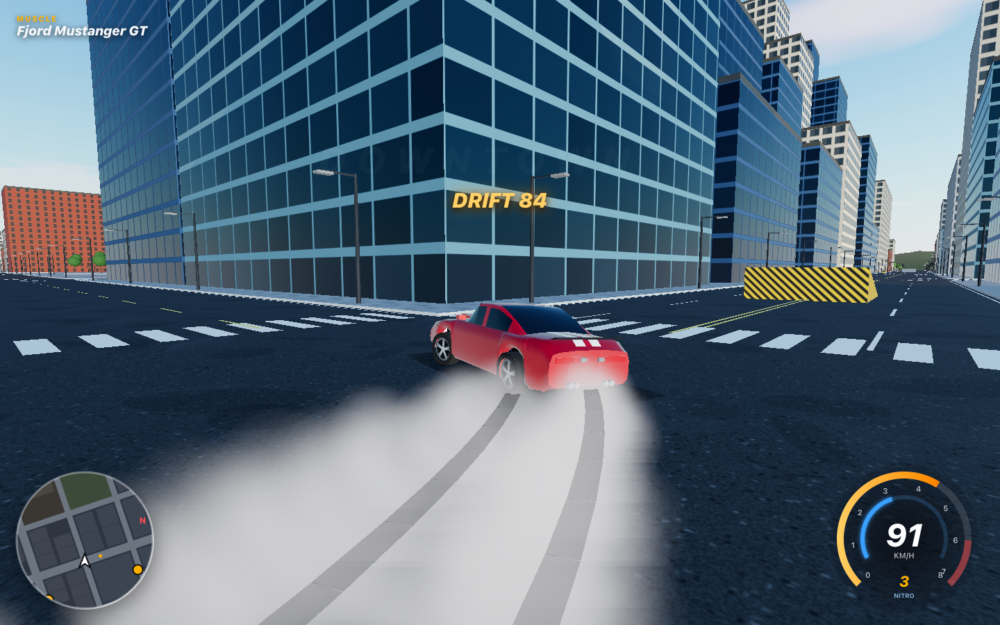

# Fairbay Heat

**An open-world 3D street racer in the browser, built without a game engine.**
Inspired by *Need for Speed: Most Wanted* (2013): drive freely around a city,
find parked cars and jack them, drift to fill your nitro, hit jumps.



## Play

**Live: https://fairbay-heat.vercel.app** (deployed on Vercel; every push to `main` on
[GitHub](https://github.com/DIVYAPRIYADHARSHINI-GIT/fairbay-heat) auto-deploys).

Run locally:

```bash
npm install
npm run dev        # http://localhost:5173
# or the production build:
npm run build && npm run preview   # http://localhost:4173
```

Click once into the page if keys don't respond, then use the keyboard.

| Key | Action |
| --- | --- |
| **W / ↑** | Accelerate |
| **S / ↓** | Brake, then reverse |
| **A D / ← →** | Steer |
| **Space** | Handbrake (start a drift) |
| **Shift** | Nitro |
| **E** | Jack a parked car you've pulled up next to |
| **G** | Garage: switch between found cars, change paint |
| **C** | Camera: chase, far chase, bumper |
| **Tab** | City map |
| **R** | Put the car back on the road |
| **T** | Skip time +3 h |
| **M** | Mute · **F** FPS counter · **H** Controls |
| **Esc / P** | Pause |

Menus are fully keyboard-driven (↑↓ choose, ←→ change, Enter select, Esc back).
Progress (found cars, current car, position, bests, settings) saves
automatically in the browser.

## Cars

Stylised, fictional takes on Most Wanted 2013 cars. The names resemble the
real cars but are not the trademarks. 0–100 km/h time and top speed are
calibrated per car and verified by unit tests.

| In game | Inspired by | Class | 0–100 | Top speed |
| --- | --- | --- | --- | --- |
| Fjord Mustanger GT (starter) | Ford Mustang GT | Muscle, RWD | 4.8 s | 250 km/h |
| Porsa 911 Carrara S | Porsche 911 Carrera S | Sports, RWD | 4.3 s | 304 km/h |
| Ashton Marvin V12 Vantis | Aston Martin V12 Vantage | Sports, RWD | 4.2 s | 305 km/h |
| Nissun GT-Arr Premium | Nissan GT-R | Sports, AWD | 3.2 s | 315 km/h |
| Lamborgino Aventura LP700 | Lamborghini Aventador | Super, AWD | 2.9 s | 350 km/h |
| Bugarri Veyrone 16.4 | Bugatti Veyron | Hyper, AWD | 2.5 s | 407 km/h |

There are 12 jack spots across the city (orange dots on the minimap and map).

## The city

Fairbay is generated from a fixed seed, so every visit has the same city:
13 × 13 street grid (120 m blocks) inside a 6-lane ring highway, about 1.4 × 1.4 km
of streets plus hills out to 2.2 × 2.2 km. Six districts: Downtown towers,
Midtown, Northshore houses, Ridge Park, the Ironworks tank farms and the
Port Fairbay container docks on the sea. It also has 11 jump ramps,
breakable lamp posts and a full day/night cycle (stars, lit windows,
street-light pools, headlights).

## How it's built: no game engine

Three.js is used **only to draw triangles** (WebGL renderer, materials,
bloom post-processing, the sky shader). Everything that makes it a game is
plain TypeScript in this repo:

| Module | What it does |
| --- | --- |
| `src/game/physics.ts` | Arcade car physics: engine curve auto-calibrated to each car's 0–100 / top speed, braking/reverse, bicycle-model steering with a grip limit, handbrake + power-over drifts, nitro, ramps/jumps, wall collisions with wall-riding. Fixed 120 Hz timestep. |
| `src/game/collision.ts` | Circle-vs-box / circle-vs-circle tests with a spatial hash |
| `src/game/city.ts` | Procedural city, districts, terrain, ramps and the ground/surface queries |
| `src/game/jack.ts`, `save.ts`, `scoring.ts` | Jack spots, defensive localStorage save, drift and jump scoring |
| `src/render/carModel.ts` | Cars generated from body dimensions: lofted body with cut wheel arches, greenhouse, lights, spoilers, wheels |
| `src/render/cityMesh.ts` | Merges the city into per-chunk meshes (about 500 draw calls for the whole city) + instanced props |
| `src/render/textures.ts` | Every texture is drawn on a canvas at load time. No image files. |
| `src/render/environment.ts`, `effects.ts`, `cameraRig.ts` | Day/night, tyre smoke, skid marks, sparks, nitro flames, speed lines, chase/bumper cameras |
| `src/audio/audio.ts` | Engine, tyre squeal, wind, impacts: all synthesised with Web Audio. No audio files. |
| `src/core/input.ts` | Held-key + pressed-edge keyboard input by physical key code |

The whole game is a 0.7 MB static site (185 KB gzipped) with no assets to download.

## Tests

```bash
npm test     # typecheck + unit + e2e
```

- **60 unit tests** (Vitest): per-car 0–100 and top-speed calibration,
  braking, reverse, steering direction, grip limits, drift entry/exit,
  drifting never creating speed, timestep independence, wall collisions
  (no tunnelling, glancing deflection), breakable lamps, ramp jumps,
  city determinism, no building on any road, clear intersections,
  jack-spot placement, save-file corruption handling, scoring.
- **64 end-to-end checks** (`tests/e2e.mjs`): the real production build in
  Chrome driven by **real key presses**: title-menu navigation, W/A/S/D
  and arrow driving, brake → reverse, handbrake drift, nitro, crashing
  into a building, a ramp jump, pulling up to a parked car and pressing E,
  camera/map/pause/time/mute/reset/garage keys, Space and arrows never
  scrolling the page, keys released on focus loss, settings, persistence
  across reload, night mode, a frame-rate check and zero console errors.
  Screenshots land in `docs/screenshots/`.

Measured: **60 fps at 1440 × 900** (Apple M1, Chrome, High quality).
The e2e suite also passes against the live site: `node tests/e2e.mjs https://fairbay-heat.vercel.app`.
`FH_GPU=0 node tests/e2e.mjs` runs the suite on software GL instead.

## Roadmap

1. ✅ **Stage 1** (this): open city, driving physics, 6 cars, jack spots, garage, day/night, HUD
2. Stage 2: traffic AI on the road grid
3. Stage 3: police chases, heat levels, roadblocks, escapes
4. Stage 4: races against AI, speed cameras, speed-trap events, more cars
